# Syfa Garage - Inventory & Sales Management System

Aplikasi web manajemen stok dan penjualan untuk bengkel/toko suku cadang motor, dibuat dengan **Laravel 12** untuk tugas **UTS Web Programming 2 - Integrated Laravel Project**.

| | |
|---|---|
| **Nama** | Syfa Zahraini |
| **NIM** | 250180077 |
| **Kelas** | A2 |

---

## 1. Project Overview

Syfa Garage membantu toko mencatat barang masuk (pembelian dari pemasok) dan barang keluar (penjualan), dengan stok yang **selalu berubah otomatis dan konsisten** mengikuti transaksi. Stok tidak bisa diketik manual di form produk: stok hanya bertambah lewat pembelian dan berkurang lewat penjualan.

Analogi sederhananya seperti rumah makan: **Staff** adalah kasir yang menerima pembelian/penjualan, **Admin** adalah pemilik yang mengelola menu (produk), pengguna, laporan, dan pembatalan, sedangkan **User** adalah pelanggan yang hanya bisa melihat menu dan stok dari HP. Akun pelanggan dibuat oleh Admin, tidak ada pendaftaran mandiri.

## 2. Requirements

- PHP **8.2** atau lebih baru, dengan ekstensi `pdo_mysql`, `mbstring`, `openssl`, `fileinfo`
- [Composer](https://getcomposer.org/) 2.x
- MySQL atau MariaDB (misalnya lewat XAMPP atau Laragon)
- Git
- Untuk menjalankan test: ekstensi PHP `pdo_sqlite` dan `sqlite3` (test memakai SQLite di memori, tidak menyentuh database MySQL)

> Node.js/npm **tidak diperlukan**. Tampilan memakai file CSS statis di `public/css/app.css`, tanpa proses build Vite.

## 3. Installation

```bash
git clone https://github.com/syfazahraini/syfa-garage.git
cd syfa-garage

composer install
cp .env.example .env      # Windows (cmd): copy .env.example .env
php artisan key:generate
```

## 4. Environment Setup

1. Nyalakan MySQL (XAMPP/Laragon), lalu buat database kosong bernama **`syfa_garage`** (misalnya lewat phpMyAdmin, collation `utf8mb4_unicode_ci`).
2. Buka file `.env` dan sesuaikan bagian database dengan komputer kamu:

```env
DB_CONNECTION=mysql
DB_HOST=127.0.0.1
DB_PORT=3306
DB_DATABASE=syfa_garage
DB_USERNAME=root
DB_PASSWORD=
```

Kredensial hanya disimpan di `.env` (tidak di-commit). Yang ada di repository hanya `.env.example`.

## 5. Migration & Seeding

```bash
php artisan migrate --seed
php artisan serve
```

Buka **http://127.0.0.1:8000**. Seeder menyiapkan 3 akun demo, 8 kategori, pemasok, dan 23 produk contoh dengan beberapa produk yang stoknya rendah.

Untuk mengulang dari awal (menghapus semua data): `php artisan migrate:fresh --seed`

## 6. Demo Account

Akun berikut hanya untuk demo (bukan kredensial pribadi):

| Role | Email | Password |
|---|---|---|
| Admin / Owner | `admin@syfagarage.test` | `password` |
| Staff (kasir) | `staff@syfagarage.test` | `password` |
| User (pelanggan) | `user@syfagarage.test` | `password` |

## 7. Features

### Hak akses per role

| Fitur | Admin | Staff | User |
|---|:-:|:-:|:-:|
| Login / logout | ✅ | ✅ | ✅ |
| Dashboard | ✅ lengkap | ✅ penjualan miliknya | ✅ ringkasan katalog |
| Lihat produk dan stok | ✅ | ✅ | ✅ (tanpa harga beli) |
| Daftar stok rendah | ✅ | ✅ | ❌ |
| CRUD kategori, produk, pemasok | ✅ | ❌ | ❌ |
| Kelola pengguna dan role | ✅ | ❌ | ❌ |
| Membuat pembelian (stock-in) | ❌ | ✅ | ❌ |
| Membuat penjualan | ❌ | ✅ | ❌ |
| Lihat transaksi | semua | hanya miliknya | ❌ |
| Batalkan transaksi | ✅ | ❌ | ❌ |

### Fitur utama

- **Autentikasi** dengan pembatasan percobaan login (10 kali per menit) dan session yang diganti setelah login.
- **Manajemen master data**: kategori, produk (SKU unik, soft delete), pemasok.
- **Pembelian (barang masuk)**: banyak item per transaksi, stok bertambah otomatis.
- **Penjualan (barang keluar)**: banyak item per transaksi, stok berkurang otomatis, total dihitung server.
- **Pembatalan transaksi** oleh Admin: stok dikembalikan; pembelian tidak bisa dibatalkan jika barangnya sudah terjual.
- **Dashboard** berbasis query agregat (`COUNT`/`SUM`): total produk, stok rendah, penjualan hari ini dan bulan ini, pembelian bulan ini, total transaksi, transaksi terbaru.
- **Pencarian, filter, dan pagination**: produk (nama/SKU/kategori), transaksi (nomor, status, rentang tanggal).
- **Validasi server-side** dengan pesan Bahasa Indonesia, serta pesan sukses/error di setiap aksi.
- **Responsif**: bisa dibuka dari HP.

### Aturan bisnis dan keamanan penting

| Aturan | Cara dijaga |
|---|---|
| Header, item, dan perubahan stok tersimpan **atomik** | `DB::transaction` di `SaleService` dan `PurchaseService`; jika satu langkah gagal, semuanya di-rollback |
| Penjualan tidak boleh melebihi stok | Stok dicek sebelum menyimpan, lalu dikurangi dengan `decrement` bersyarat `where stock >= qty` sebagai pengaman kedua |
| Dua penjualan bersamaan pada produk yang sama | `lockForUpdate()` pada baris produk, diurutkan berdasarkan `id` untuk mencegah deadlock |
| Harga tidak bisa dimanipulasi dari browser | Harga dan total selalu diambil/dihitung server dari database; input harga dari form diabaikan |
| Produk yang sudah bertransaksi tidak hilang | Soft delete pada produk, `restrictOnDelete` pada foreign key transaksi |
| Staff/User tidak bisa mengakses fungsi Admin lewat URL | Gate dan middleware `can:` pada route, Form Request `authorize()`, dan Policy untuk detail transaksi; menyembunyikan tombol hanya tampilan |
| Mass assignment | `role` tidak ada di `$fillable`, diisi eksplisit oleh Admin |
| Pencarian aman | Karakter khusus `LIKE` di-escape (`App\Support\Search`) |
| Dasar keamanan | CSRF token, escaping output Blade, password di-hash, kredensial di `.env` |

### Struktur kode inti

```
app/
├── Services/            SaleService, PurchaseService (logika stok dan transaksi)
├── Http/Controllers/    Controller tipis: request dan response saja
├── Http/Requests/       Validasi dan authorize per form
├── Policies/            SalePolicy, PurchasePolicy (Staff hanya miliknya)
├── Providers/AppServiceProvider.php   Definisi Gate per role
├── Models/              Relasi Eloquent
routes/web.php           Route dan middleware akses
database/migrations/     Skema tabel, index, foreign key
database/seeders/        Data demo
tests/Feature/           Test otomatis
```

## 8. ERD dan Relasi

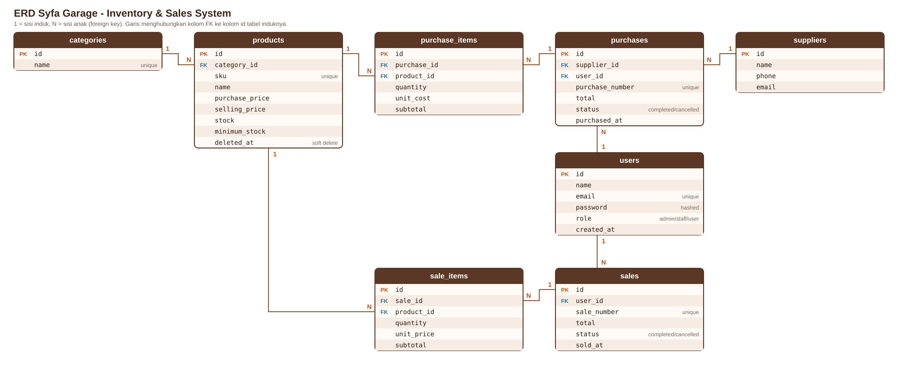

Relasi Eloquent:

| Relasi | Penjelasan |
|---|---|
| `Category` hasMany `Product`; `Product` belongsTo `Category` | Satu kategori punya banyak produk |
| `Supplier` hasMany `Purchase`; `Purchase` belongsTo `Supplier` | Satu pemasok bisa punya banyak pembelian |
| `Purchase` hasMany `PurchaseItem`; `PurchaseItem` belongsTo `Purchase` dan `Product` | Satu pembelian berisi banyak item |
| `Sale` hasMany `SaleItem`; `SaleItem` belongsTo `Sale` dan `Product` | Satu penjualan berisi banyak item (header-detail) |
| `User` hasMany `Purchase` dan `Sale` | Mencatat siapa yang membuat transaksi |

Kenapa header dan item dipisah (`Sale` hasMany `SaleItem`)? Satu transaksi bisa berisi banyak produk dengan jumlah dan harga masing-masing. `unit_price` disimpan di item supaya riwayat tetap benar walaupun harga produk berubah di kemudian hari.

Foreign key dan index: semua relasi memakai foreign key; `sku`, `sale_number`, `purchase_number`, dan `email` bersifat unik; kolom `status`, `sold_at`, `purchased_at`, dan `role` diberi index untuk pencarian/filter.

## 9. Testing

```bash
php artisan test
```

Hasil terakhir: **53 test lulus (201 assertion)**.

| File test | Yang diuji |
|---|---|
| `AuthenticationTest` | login benar/salah, logout, halaman butuh login, tidak ada register |
| `ProductTest` | SKU duplikat, harga negatif, stok awal 0, soft delete |
| `PurchaseTest` | pembelian menambah stok, validasi, pembatalan |
| `SaleTest` | pengurangan stok, harga dari database, stok tidak cukup, **atomicity (rollback)**, pembatalan |
| `AuthorizationTest` | batas hak akses Admin, Staff, dan User, termasuk akses langsung lewat URL/POST |
| `DashboardTest` | isi dashboard per role, transaksi batal tidak dihitung |
| `SearchAndPaginationTest` | pencarian, filter, pagination, input filter tidak valid |

Test memakai SQLite di memori (`phpunit.xml`), jadi database MySQL tidak tersentuh.

## 10. Screenshots

Semua gambar ada di `docs/screenshots/`.

### Admin

**Login**

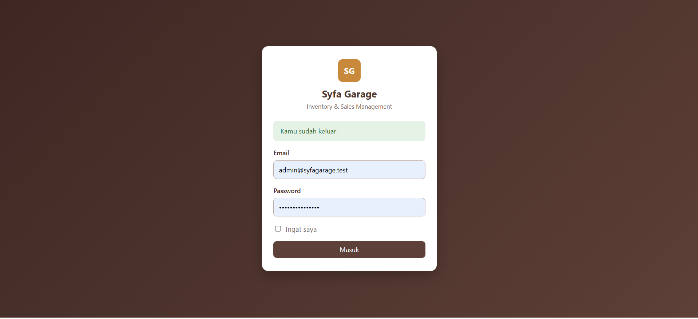

Halaman login sistem.

**Dashboard Admin**

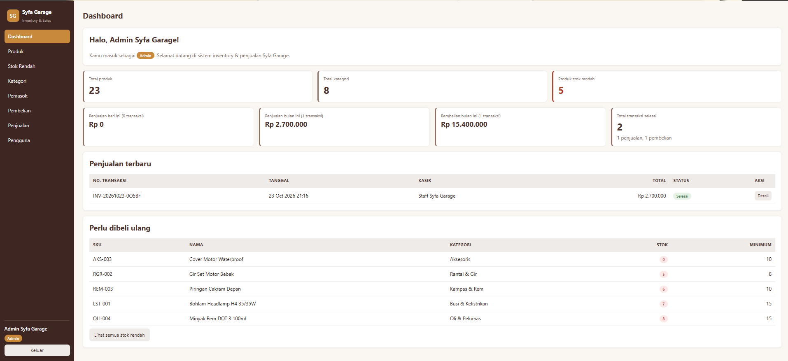

Ringkasan produk, penjualan, pembelian, dan stok rendah dari seluruh pengguna.

**Daftar produk**

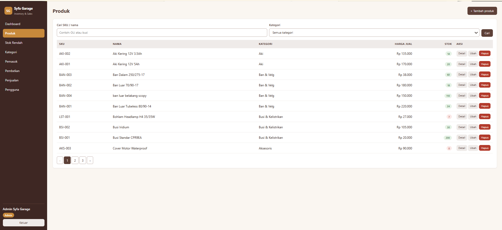

Daftar produk dengan pencarian, filter kategori, dan pagination.

**Stok rendah**

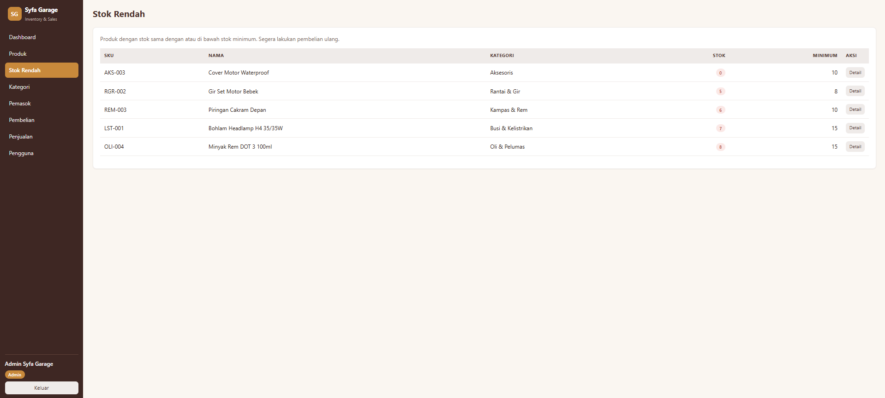

Produk yang stoknya di bawah atau sama dengan stok minimum.

**Daftar kategori**

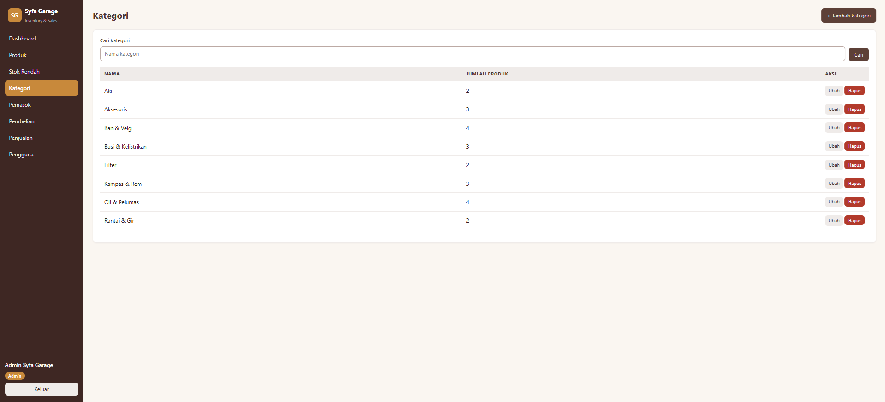

Daftar kategori produk.

**Daftar pemasok**

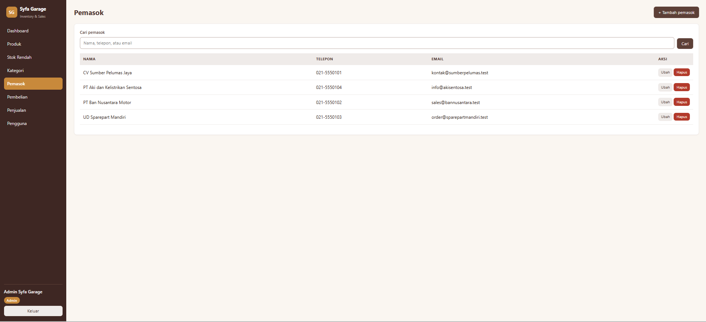

Daftar pemasok.

**Daftar pembelian**

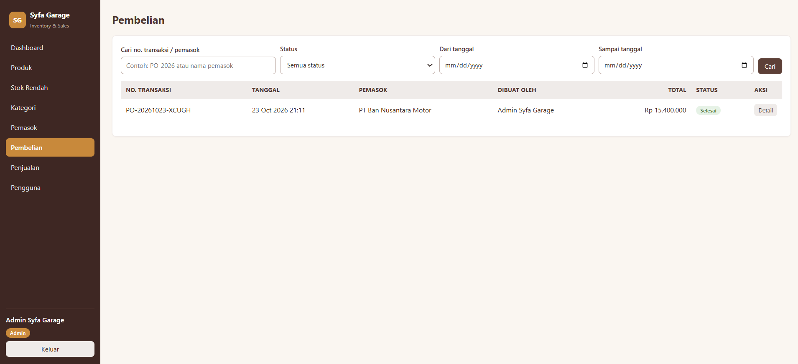

Daftar pembelian (barang masuk) dengan filter status dan tanggal.

**Daftar penjualan**

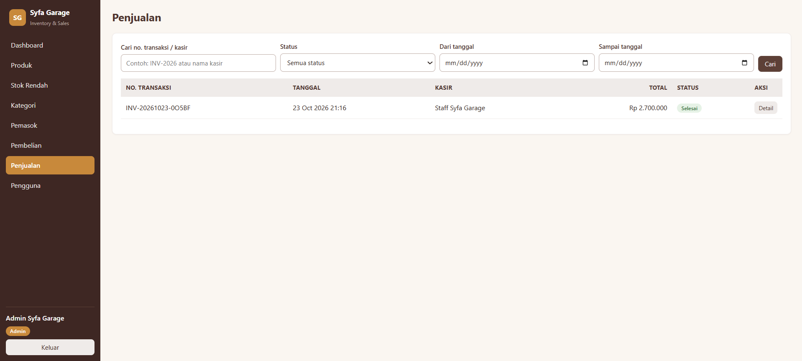

Daftar penjualan (barang keluar) dengan filter status dan tanggal.

**Daftar pengguna**

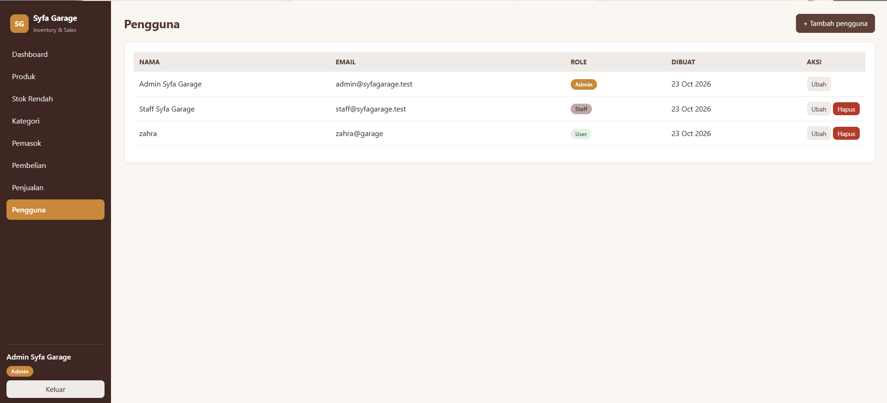

Manajemen pengguna dan role (hanya Admin).

### Staff (kasir)

**Dashboard Staff**

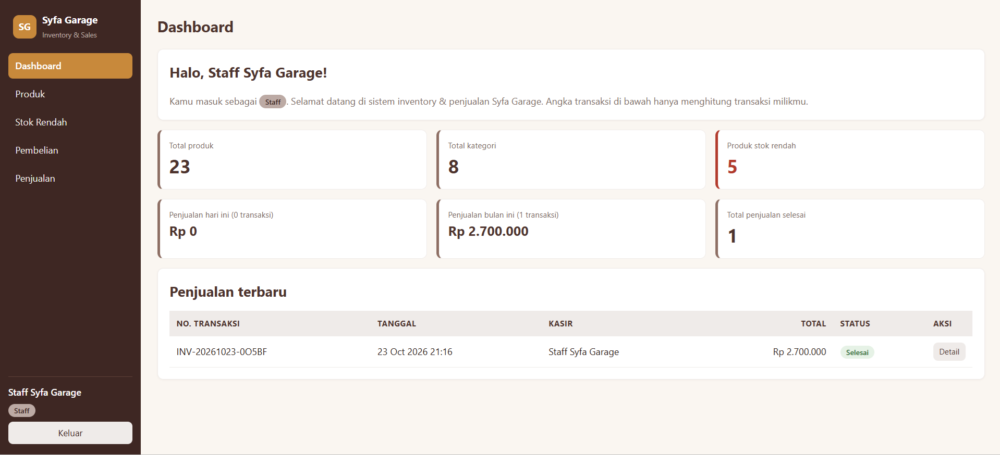

Hanya menampilkan penjualan milik staff yang login.

**Penjualan berhasil**

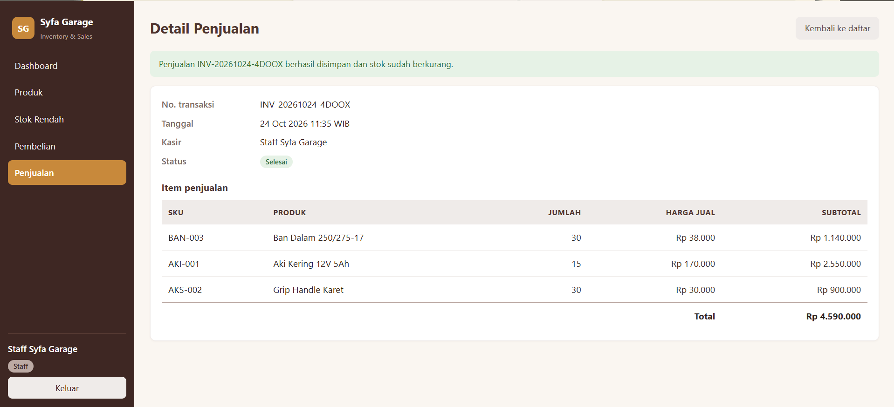

Detail penjualan setelah disimpan: nomor transaksi, item, harga dari database, dan total.

**Pembelian berhasil**

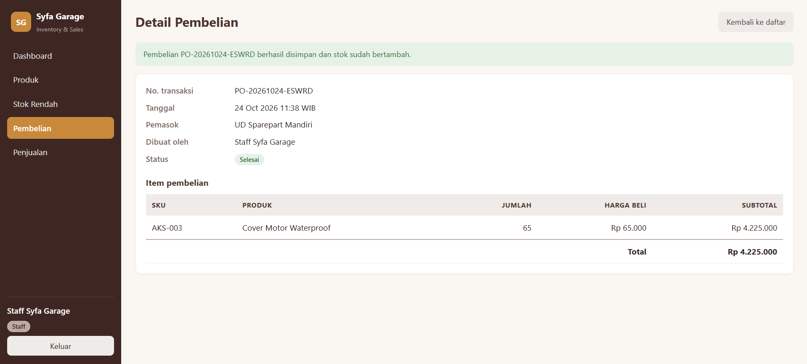

Detail pembelian setelah disimpan, stok produk bertambah.

### User (pelanggan)

**Dashboard User**

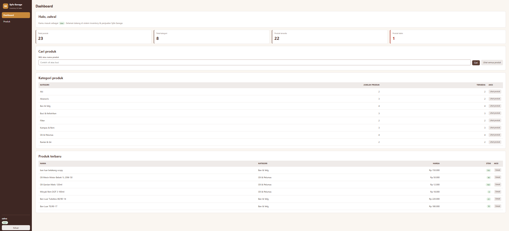

Hanya menampilkan ketersediaan produk, kategori, dan produk terbaru, tanpa data transaksi.

### Validasi dan keamanan

**Stok tidak cukup**

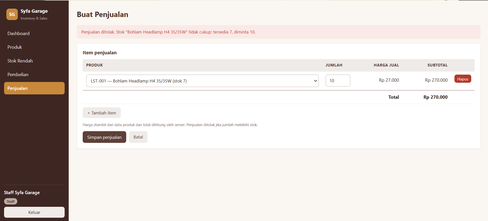

Penjualan ditolak karena jumlah yang diminta (10) melebihi stok tersedia (7). Transaksi tidak tersimpan.

**Kategori duplikat**

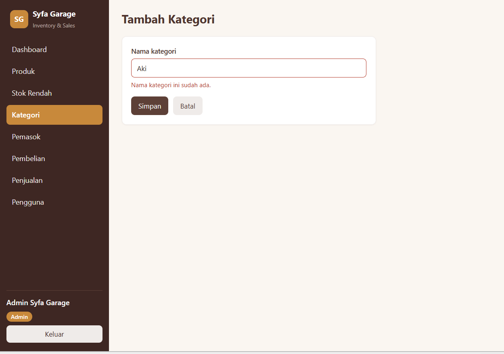

Nama kategori yang sudah ada ditolak.

**SKU duplikat**

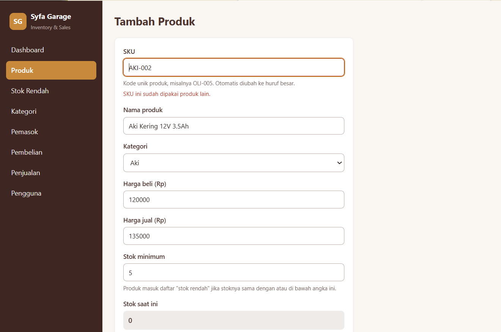

SKU produk yang sudah ada ditolak.

**Akses ditolak (403)**

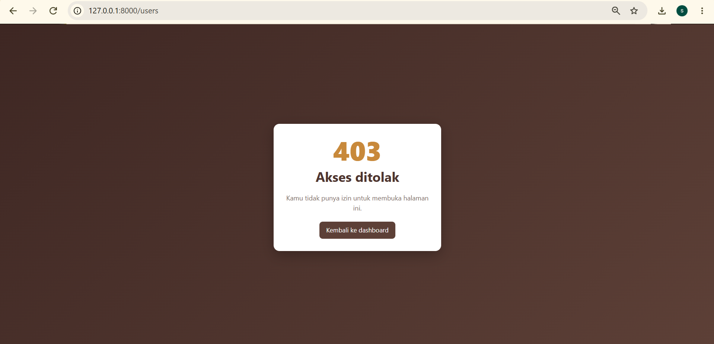

Pengguna tanpa hak akses tidak bisa membuka halaman Pengguna lewat URL langsung.

### Pengujian

**Hasil `php artisan test`**

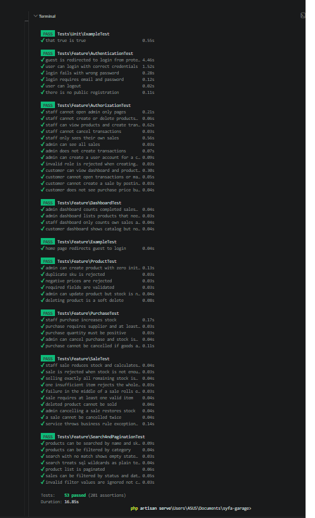

53 test lulus (201 assertion).

## 11. Known Limitations

- **Test belum membuktikan pengamanan konkurensi.** Test berjalan di SQLite, yang mengabaikan `lockForUpdate()`. Perlindungan terhadap dua penjualan bersamaan dijaga lewat kode (kunci baris + `decrement` bersyarat), tetapi tidak diuji otomatis dengan dua proses paralel.
- Satu gudang saja; tidak ada retur parsial, diskon, pajak, atau pembayaran online.
- Pembatalan berlaku untuk seluruh transaksi, bukan per item.
- Pembelian yang barangnya sudah terjual tidak bisa dibatalkan (agar stok tidak negatif).
- Tidak ada fitur lupa password; Admin mengatur ulang password lewat menu Pengguna.
- Belum ada ekspor laporan (PDF/Excel) dan riwayat perubahan harga produk.
- Pelanggan (role User) hanya melihat katalog; belum ada pemesanan dari HP, transaksi tetap lewat kasir.

## 12. Atribusi

Dibangun dengan framework [Laravel 12](https://laravel.com/docs). Data produk, pemasok, dan akun adalah data dummy.

<!-- Tulis di sini sumber lain yang kamu pakai (referensi, library, tools, atau bantuan AI) sesuai aturan dosen. -->
